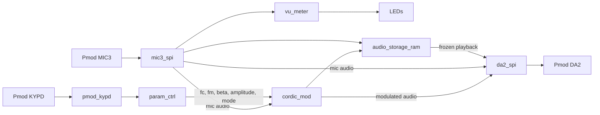

# cordic-dsp-fm

Real-time audio modulation on an FPGA. A CORDIC engine generates FM, PM and AM
signals from a test tone or live microphone audio, with every parameter set
from a keypad while the design runs.

Built for and tested on the **Avnet ZedBoard** (Zynq-7000 `xc7z020clg484-1`) with
Vivado 2025.2. To use another board, edit the constraints file.

---

## Project status

*Last updated: 22 November 2026*

All core blocks are written and pass simulation. Everything is combined on the
`beta` branch ([PR #3](https://github.com/ultimus2935/cordic-dsp-fm/pull/3)),
which is waiting to be merged into `main`. The next milestone is testing the
full system on the board.

| Block | What it does | Status |
|---|---|---|
| Microphone input (Pmod MIC3) | Reads 12-bit audio at ~48 kHz | Done |
| DAC output (Pmod DA2) | Two output channels: modulated signal and original mic | Done |
| VU meter | Mic level on the LEDs, with automatic DC offset tracking | Done |
| Keypad control (Pmod KYPD) | Sets carrier, message frequency, index, amplitude and mode | Done |
| CORDIC modulator | FM, PM, AM and carrier only, from a test tone or the mic | Done, verified in simulation |
| Audio RAM storage | Records the last ~43 ms of mic and modulated audio, freeze and loop on demand | Done |
| VIO live debugging | Optional JTAG dashboard of internal signals | Done |
| Full-system test on the ZedBoard | | In progress |
| VGA display | | Planned |

---

## How it works



A clocking wizard turns the board's 100 MHz clock into 32 MHz. Every 667 clock
cycles (a sample rate of 47.976 kHz), the system:

1. reads one sample from the microphone,
2. computes one modulated sample with the CORDIC modulator,
3. sends both to the two DAC channels.

The **CORDIC modulator** (`cordic_core.v` and `cordic_mod.v`) computes sines
using only shifts and adds. It uses a single CORDIC unit twice per sample: once
for the message (the test tone, or the mic audio) and once for the modulated
carrier. Each sample takes 42 of the 667 available clock cycles.

| Mode | Output |
|---|---|
| FM | The carrier's frequency follows the message. Peak deviation is beta x fm. |
| PM | The carrier's phase follows the message, by up to beta radians. |
| AM | The carrier's amplitude follows the message. Depth is beta, capped at 100 %. |
| Carrier only | A plain sine at fc |

Parameters are captured at the start of each sample, so a key press never
corrupts a sample being computed. Changes to fc, fm or deviation are click-free.

---

## Hardware setup

| Pmod | Header | Notes |
|---|---|---|
| KYPD (keypad) | JA | Both rows |
| DA2 (DAC) | JC | Top row |
| MIC3 (microphone) | JD | Top row |

The DA2 has no audio jack. Connect VOUTA / VOUTB to a powered speaker or small
amplifier, or to an oscilloscope. The outputs are centred on about 1.65 V, so
use AC coupling. An oscilloscope with FFT mode is the best way to see the
modulation spectrum.

### Switches and buttons

| Control | Function |
|---|---|
| BTNR | Reset |
| SW0 | LEDs: 0 = keypad status, 1 = VU meter (mic level) |
| SW1 | Message source: 0 = internal test tone at fm, 1 = microphone |
| SW2 | Audio RAM: 0 = record continuously, 1 = freeze the buffer and loop it to the DAC |
| SW7 | DAC channels: 0 = A modulated / B mic, 1 = A mic / B modulated |

In mic mode the mic's DC offset is removed automatically. A full-scale mic signal
gives the full FM deviation (beta x fm). If the effect is weak, turn up the gain
knob on the MIC3.

### Keypad

```
[ 1 ][ 2 ][ 3 ][ A ]    0-9  type a value          A    next parameter
[ 4 ][ 5 ][ 6 ][ B ]    D    enter (apply)         B    modulation type
[ 7 ][ 8 ][ 9 ][ C ]    C    clear typed digits    E/F  step up/down (hold = repeat)
[ 0 ][ F ][ E ][ D ]
```

| # | Parameter | Typed as | Step | Range | Default |
|---|---|---|---|---|---|
| 0 | Carrier frequency `fc_hz` | Hz | 50 | 100–12000 | 1000 |
| 1 | Message frequency `fm_hz` (mic mode: deviation scale) | Hz | 5 | 1–1000 | 50 |
| 2 | Modulation index `beta_x10` | tenths (25 = 2.5) | 0.5 | 0–10 | 2.0 |
| 3 | Amplitude `amp_pct` | % | 5 | 0–100 | 80 |

The modulation mode starts at FM. Values outside the range are clamped.

**LEDs** (SW0 off):
- LD0–LD3 show the selected parameter.
- LD5–LD6 show the mode: 00 FM, 01 PM, 10 AM, 11 carrier only.
- LD7 shows the status: a slow blink while typing, a short flash when a value is applied, and a fast blink when a value was clamped.

The key map is set by the `KEY_*` localparams in `param_ctrl.v`.

### Things to try

| Setting | What you should hear or see |
|---|---|
| FM, fm = 5, beta = 10 (type `100`) | A clear warble around the carrier |
| AM, fm = 5, beta = 1.0 (type `10`) | Tremolo: the volume pulses 5 times a second |
| FM or PM, beta = 2.4 (type `24`) | On a scope FFT, the carrier almost disappears (Bessel null) |
| SW1 = 1, speak into the mic | Your voice modulates the carrier |
| Carrier only, step fc with E/F | The pitch slides with no clicks |

---

## Building in Vivado

1. Create an RTL project for `xc7z020clg484-1`.
2. Add every file in `src/design/` as design sources and `src/constraints/zedboard.xdc` as constraints. The top module is `top`.
3. **Create the clocking wizard IP.** It is not stored in this repository. Make an IP named `clk_wiz_0` with:
   - input clock: 100 MHz
   - output `clk_out1`: 32 MHz
   - **reset** and **locked** ports both enabled, reset active high

   If `locked` is missing, the design stays in reset and nothing works.
4. Run synthesis and implementation, generate the bitstream, and program the board.

Do **not** add `src/simulation/models/clk_wiz_0_sim.v` to the Vivado project. It is
a clock model for Icarus Verilog only.

---

## Simulation and verification

| Testbench | What it checks |
|---|---|
| `tb_cordic_mod.v` + `check_cordic_mod.py` | 9 directed modulator tests: every mode, extreme settings, zero amplitude, and a parameter change mid-sample |
| `tb_cordic_mod_stress.v` + `check_cordic_mod.py --stress` | Random parameters, irregular sample timing and resets |
| `tb_top.v` | Full system with models of the MIC3, DA2 and KYPD: reset, sample rate, DAC framing, SW7 swap, keypad to CORDIC, mic as message, VU meter |
| `tb_keypad.v` | Keypad scanning, debouncing and parameter entry |
| `tb_vu_meter.v` | VU meter |

**CORDIC modulator results:**
- The hardware matches a bit-exact Python model with 0 mismatches, in all directed tests and over 17,000 random stress samples.
- The output is within 1.5 LSB of ideal floating-point maths.
- FM and PM sidebands match Bessel theory within 0.3 dB, and spurs are below −70 dBc.
- Synthesis meets timing with a large margin. The modulator uses about 580 LUTs and 8 DSP blocks.

These checks run with the test tone as the message. The mic message path is
covered by `tb_top.v`.

Run the modulator checks (ModelSim, Vivado xsim or Icarus; Python with NumPy):

```bash
iverilog -g2012 -o tb_cm src/simulation/tb_cordic_mod.v src/design/cordic_core.v src/design/cordic_mod.v && vvp tb_cm
python src/simulation/check_cordic_mod.py cordic_mod_out.txt
```

Full-system simulation (Icarus Verilog):

```bash
iverilog -g2012 -o tb_top src/simulation/tb_top.v src/simulation/models/clk_wiz_0_sim.v src/design/*.v && vvp tb_top
```

Keypad-only simulation:

```bash
iverilog -g2012 src/simulation/tb_keypad.v src/design/pmod_kypd.v src/design/param_ctrl.v && vvp a.out
```

---

## Live debugging with VIO (optional)

1. With the Vivado project open, run `source src/ip/create_vio.tcl` in the Tcl console. It creates `vio_0` and sets the `USE_VIO` define.
2. Generate the bitstream and program the board (Vivado loads the `.ltx` probes file too). Open the **hw_vio_1** tab, add all probes, and set them to unsigned decimal.

| Probe | Signal | What to check |
|---|---|---|
| in0 | `mic_audio_data` (12 b) | ~2048 in silence, swings when you speak |
| in1 | `vu_level` | VU bar pattern |
| in2–in5 | `fc_hz`, `fm_hz`, `beta_x10`, `amp_pct` | parameter values |
| in6 | `{mod_type, sel_param}` | [2:0] selected param, [4:3] mode |
| in7 | `entry_value` | digits being typed |
| in8 | `{key_held, key_code}` | last key pressed, held flag |
| in9 | `fc_fcw` | carrier phase increment |
| in10 | `{sys_rst, clk_locked}` | expect reset 0, locked 1 |
| out0 / out1 / out2 | `vio_key` / `vio_press` / `vio_en` | with `vio_en` = 1, set a key and toggle `vio_press` 0→1→0 to inject one press |

VIO refreshes every few hundred ms, so `mic_audio_data` shows snapshots, not a
waveform. Use an ILA for waveforms and single-cycle pulses. To build without
VIO, clear the define: `set_property verilog_define {} [current_fileset]`.

---

## Repository layout

```
src/
  design/
    top_module.v          top level: clocking, reset, sample timer, wiring
    mic3_spi.v            Pmod MIC3 reader
    da2_spi.v             Pmod DA2 writer (two channels)
    vu_meter.v            mic level to LEDs
    pmod_kypd.v           keypad scanner and debouncer
    param_ctrl.v          keypad UI and modulation parameters
    cordic_core.v         shift-and-add sine/cosine generator
    cordic_mod.v          FM / PM / AM modulator
    audio_storage_ram.v   block RAM record / freeze buffer
  constraints/
    zedboard.xdc          pin assignments
  ip/
    create_vio.tcl        optional VIO debug core
  simulation/             testbenches, models and the Python checker
```

---

## Known limitations

- **Clicks:** changing the mode, beta or amplitude takes effect instantly and can cause a small click.
- **AM volume:** AM output is about half as loud as the other modes. This leaves room for 100 % modulation depth without clipping.
- **Aliasing:** fm and beta are limited to keep FM sidebands below 24 kHz, but settings near the top of every range can still alias slightly.
- **Staircase output:** the DA2 has no smoothing filter, so the output steps at the sample rate. This is expected.
- **Clock IP not in the repo:** everyone must create `clk_wiz_0` locally, as described above.

---

## Team

| Member | Area |
|---|---|
| [@ultimus2935](https://github.com/ultimus2935) | Mic and DAC interfaces, VU meter, top level, audio RAM storage |
| [@achalram](https://github.com/achalram) | Keypad control, reset synchroniser, VIO debugging, mic-as-message, system testbench |
| [@oishik1306](https://github.com/oishik1306) | CORDIC DSP: sine generator, FM/PM/AM modulator and its verification |
